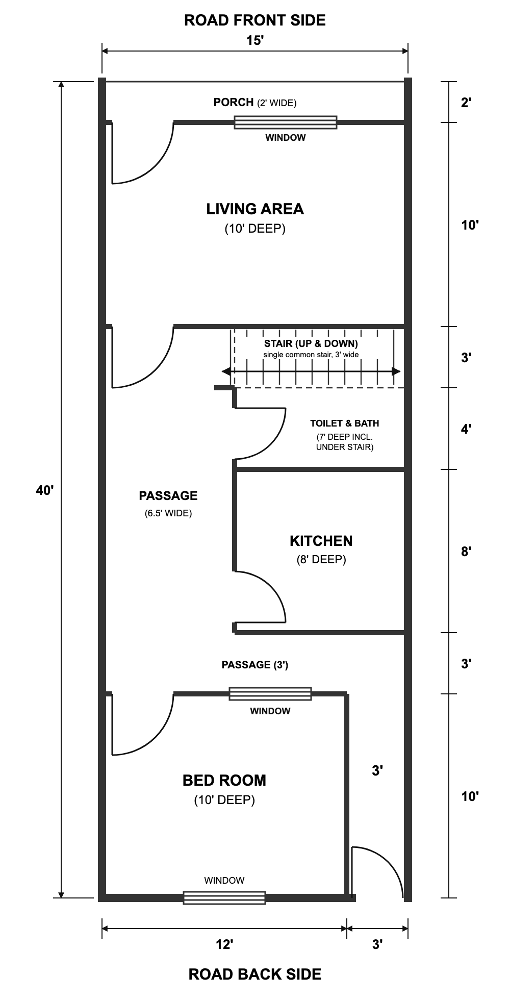

# 15' x 40' House - 3D Walkthrough

An interactive, fully procedural 3D architectural walkthrough of a 15' x 40' row house built with **Three.js** and **Vite**.

The entire house—including walls, floors, doors, windows, the staircase, and custom furniture—is generated dynamically via code (no external 3D models or image assets). It features a first-person Walk Mode, an architectural Dollhouse Mode, and a guided automated tour.

## 📐 Floor Plan

The 3D geometry is built entirely from scratch based on this original 2D sketch:


_The original architectural floor plan used as the blueprint for the 3D layout._

---

## 📸 Screenshots

_(Run the `shot.sh` script to populate the `shots/` directory with the latest visuals)._

### Architectural Dollhouse View


_The ground floor layout viewed in isometric Dollhouse mode._

### First Floor & Terrace


_The first floor showing bedrooms, lobby, and open terrace._

### First-Person Walk Mode


_Interior view of the living area, showcasing procedural furniture and lighting._

---

## ✨ Features

- **Dual View Modes**:
  - **Walk Mode**: Immersive first-person exploration with collision detection and stair-climbing logic.
  - **Dollhouse Mode**: A 3D isometric view allowing you to rotate, pan, and zoom around the house. Includes buttons to toggle between Ground Floor, First Floor, or the Full House.
- **Guided Tour**: An automated camera path that seamlessly transitions between all rooms.
- **Bilingual UI**: Toggle between English and Hindi.
- **Mobile & Touch Support**: Responsive layout with an on-screen virtual joystick for mobile walking.
- **Procedural Textures**: All textures (tiles, wood, concrete, grass, fabric) are generated on the fly using HTML5 Canvas and deterministic noise algorithms.
- **Smart Stair System**: Automatically transitions the player camera from ground floor collision boxes to stair-ramp mode, and finally to the first floor.
- **Headless Physics Testing**: Includes a custom Node.js test script to verify collisions and walkability without a browser.

---

## 🛠 Tech Stack

- **Framework**: [Vite](https://vitejs.dev/)
- **3D Engine**: [Three.js](https://threejs.org/)
- **Language**: Vanilla JavaScript (ES Modules)
- **Testing**: Custom Node.js headless physics test

---

## 🚀 Getting Started

### Prerequisites

- Node.js (v18.0.0 or higher)
- npm

### Installation

```bash
# Clone or navigate to the project directory
cd walkthrough

# Install dependencies
npm install
```
